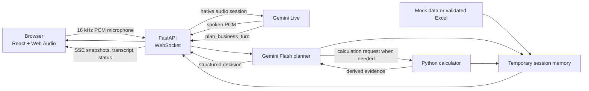

# Seller Studio — one-page architecture

Seller Studio is a short voice conversation prototype for the Snapdeal KAM assignment. A seller loads the assignment’s five metrics or a constrained Excel sheet, then talks naturally about what changed in their business. It has no login, production database, Snapdeal integration, or durable customer record.

**Voice and UI.** The browser sends short PCM audio chunks over a WebSocket; FastAPI keeps the Gemini key on the server and relays audio to Gemini Live. Gemini Live provides speech recognition, voice generation, language handling, interruption support and turn-taking. SSE updates the right panel with only accepted state: seller facts, data observations, open uncertainties, recommendations, transcript and activity. No separate STT or TTS provider is needed.

**Conversation intelligence.** For every meaningful seller utterance, Gemini Live must call the backend’s `plan_business_turn` function before it speaks. The planner receives the current seller transcript, all dataset and calculation evidence, attributed seller facts, a running conversation summary, and the most recent **15 complete conversation turns**. The seller's goal is business advice. The latency-critical response contains speech, a natural follow-up, seller facts, cited evidence, typed numeric references and optional calculation requests. It can continue discovery for as many turns as the seller's situation needs, but asks only gaps that materially change useful, safe advice; one answer does not automatically trigger recommendations. It asks one focused question per spoken turn so the seller can answer naturally. Recommendations begin as soon as the context supports an action and become conditional when a necessary uncertainty remains. Questions are model-generated from context; there is no fixed question tree or regex interpretation. A separate “period comparability” setting does not exist. The planner asks about timing only if it affects the specific answer.

**Memory.** Each browser has an unguessable HttpOnly cookie that locates one temporary in-memory session. The session contains the chosen data, a running summary, 15 recent seller/assistant turns, seller-stated facts, current recommendations, and all evidence. The summary refreshes in the background once the transcript becomes substantial or old turns are dropped; it never blocks voice playback. It preserves older relevant details, constraints, corrections, advice and unresolved issues. It is visible in the UI and contains no hidden chain-of-thought. Sessions expire after 30 inactive minutes; server restart or redeploy also clears them.

**Data and calculation tool.** Excel input is restricted to one small `Metric / Last Month / This Month` worksheet. Python precomputes straightforward changes when data loads. If the planner needs arithmetic during a call, it requests a typed operation—difference, percentage change, or ratio—with evidence IDs, never arbitrary values. Python validates units and denominators and computes it deterministically. The result, input values, provenance and qualification are saved as `calculated.*` entries in the **same `dataset.evidence` collection** as the spreadsheet metrics. If a seller corrects an input, dependent derived evidence disappears. The planner makes one final response using the new evidence; it cannot create an unbounded calculation loop.

**Accuracy controls and limits.** Spreadsheet values remain authoritative; seller corrections are separately attributed. Every stored seller fact needs an exact quote from the current seller utterance. Typed metric references must match the actual evidence number. Findings and recommendations need valid evidence IDs, and unsupported plans are rejected before their speech is released. These controls reduce invented figures and mistaken arithmetic; they cannot prove that all model language is true or establish causation from correlations. The prototype should be evaluated with corrections, unknown answers, interruptions, Hindi/Hinglish, incomplete periods and requests for immediate advice.

**Deployment.** One FastAPI process serves the built React files, API, SSE and WebSocket. Use exactly one worker because session memory belongs to that process. HTTPS is required outside localhost for microphone access. A free single-instance host is suitable for a demo, but sleep/restart loses temporary sessions and may add cold-start delay. For a multi-instance or durable product, move session state to Redis/database and use sticky routing or shared session storage.
